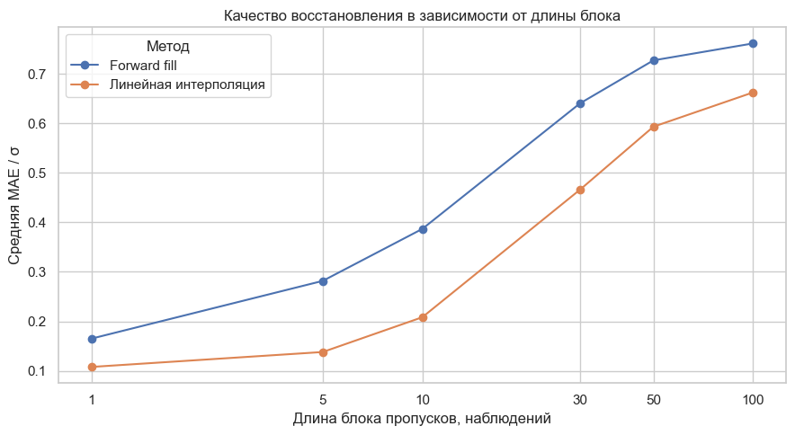

# IMU Sensor Analysis

Статистический анализ измерений инерциального модуля на промышленном манипуляторе: распределения сигналов, потенциальные аномалии и восстановление пропусков. Проект подготовлен на основе учебного практикума.

**Автор:** Калюжина С.О.  
**Стек:** Python · pandas · NumPy · SciPy · scikit-learn · statsmodels · Matplotlib · seaborn.



## Задачи и методы

| Задача | Методы |
|---|---|
| Проверка качества данных | пропуски, дубликаты, нулевые векторы, интервалы измерений |
| Распределения девяти сенсорных признаков | гистограммы, KDE, Scott/Silverman, подбор bandwidth |
| Зависимости и режимы работы | условные распределения, диаграммы рассеяния, порог гироскопа |
| Потенциальные аномалии | IQR, z-score, Граббс, ESD, Диксон, Isolation Forest, LOF |
| Восстановление значений | среднее, медиана, forward fill, интерполяция по времени, KNN |
| Нормальность | Q-Q, поточечная огибающая, пять критериев, моделирование CVM |

Основной анализ и графики находятся в **[imu_analysis.ipynb](imu_analysis.ipynb)**. Исследуется предоставленный CSV из 874 937 наблюдений, а не весь исходный датасет CASPER.

## Что показывает исследование

- Объединение режимов с разной интенсивностью движения даёт сложные, часто многомодальные распределения; глобальная экстремальность не равнозначна ошибке датчика.
- Алгоритмы аномалий выделяют разные наблюдения. Без внешней разметки нельзя определить, какой из них точнее обнаруживает реальные неисправности.
- Для искусственно скрытых редких значений временная интерполяция в этом эксперименте даёт меньшую среднюю нормированную ошибку, чем заполнение средним, медианой или предыдущим значением. Длинные блоки восстанавливаются хуже.
- Отклонение от нормальности необходимо интерпретировать с учётом квантования, зависимости во времени и размера выборки.

Численные результаты приведены в таблицах ноутбука. Исследование не является системой диагностики неисправностей или сравнением детекторов на размеченной тестовой выборке.

## Запуск

```bash
python3 -m venv .venv
source .venv/bin/activate
pip install -r requirements-notebook.txt
```

Поместите `IMU_10Hz.csv` в `data/`. Файл не включён в репозиторий; источник, контрольная сумма и ограничения воспроизведения описаны в **[data/README.md](data/README.md)**.

```bash
jupyter lab imu_analysis.ipynb
```

## Автоматические проверки

```bash
python -m unittest -v
```

Семь тестов не требуют датасета и проверяют валидацию входных данных, интерполяцию на неравномерной сетке и сохранение точности наносекундных меток, отсутствие экстраполяции, согласованность вероятностей смеси, формулу CVM, обработку экстремальных/вырожденных выборок и инвариантность Шапиро–Франсия к масштабу.


## Источники

- [Industrial Robotic Arm — IMU Data (CASPER 1 & 2)](https://www.kaggle.com/datasets/hkayan/industrial-robotic-arm-imu-data-casper-1-and-2).
- [Kayan et al., CASPER, 2024](https://ngcharithperera.gitlab.io/publications/pdfs/Kayan2024a.pdf).
